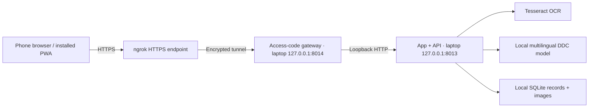

# Phone access while the laptop runs

The laptop serves both the website and the model. A public HTTPS tunnel lets a
phone reach it over Wi-Fi or mobile data. No separate frontend deployment, router
port forwarding, or public model upload is needed.



The tunnel provider carries requests and responses, including access-code login,
book photos, text and results. TLS terminates at the provider; this is not an
end-to-end encrypted channel that hides content from the provider. Sharing grants
all access-code holders access to the same research collection, including exports
and deletion. Use it only with the intended research team and suitable book scans.
This is a small-team testing setup, not a multi-user public service.

## Start: test the app on a phone using ngrok

Phone access is already implemented and was exercised in the user's English and
Hindi capture tests on 4 October 2026. A teammate can open the laptop's app from
Safari/Chrome on a phone, including over mobile data. The laptop performs OCR and
classification; the phone takes/uploads the photos. `127.0.0.1` on the phone
refers to the phone itself, so use the generated HTTPS link.

### One-time setup on each teammate's laptop

Complete [the project setup](../RUN_GUIDE.md) first. Then install the ngrok CLI
using its [official setup instructions](https://ngrok.com/docs/getting-started/),
create/sign in to an ngrok account and copy the account's agent authtoken from
its dashboard. Add it to the local ngrok configuration:

```sh
ngrok config add-authtoken YOUR_NGROK_AUTHTOKEN
ngrok version
ngrok config check
```

Replace the placeholder with your own token; keep it out of project files, Git
and shared screenshots. This ngrok account token is different from the app's
phone login code. The configured CLI must be available as `ngrok` in the terminal
used to launch sharing. See the [official CLI reference](https://ngrok.com/docs/gateway/agent/cli#ngrok-config-add-authtoken).

### Mac: two Terminal windows

Run these from the extracted/cloned project folder after setup.
In Terminal 1, start the app:

```sh
FIELDNOTE_OCR=portable FIELDNOTE_DB=output/fieldnote/macos-demo.sqlite3 \
  .venv/bin/python -m prototype.run --port 8013 --model native_silver_v2
```

Keep it running. In Terminal 2, from the same project folder:

```sh
.venv/bin/python -m prototype.share --backend-port 8013
```

Alternatively, double-click `scripts/macos-start.command`, then
`scripts/macos-share.command`. Both shortcuts use backend port 8013.

### Windows: two Command Prompt windows

Run these from the extracted/cloned project folder after setup.
In Command Prompt 1:

```bat
set FIELDNOTE_OCR=portable
set FIELDNOTE_DB=output/fieldnote/windows-demo.sqlite3
.venv\Scripts\python.exe -m prototype.run --port 8013 --model native_silver_v2
```

Keep it running. In Command Prompt 2, from the same project folder:

```bat
.venv\Scripts\python.exe -m prototype.share --backend-port 8013
```

Alternatively, double-click `scripts\windows-start.cmd`, then
`scripts\windows-share.cmd`. Both shortcuts use backend port 8013.

### Connect to the current fresh test on port 8017

If the app is already running on 8017, leave it running and share that exact port
instead of starting another app. In a second terminal, from the project folder:

Mac:

```sh
.venv/bin/python -m prototype.share --backend-port 8017
```

Windows Command Prompt:

```bat
.venv\Scripts\python.exe -m prototype.share --backend-port 8017
```

The `--backend-port` must match the app's port. The packaged share shortcuts
always target 8013, so use these explicit commands for 8017. Sharing uses the
model and capture database in that running server; it does not retrain the model
or create a second classifier process. The launcher starts ngrok and the
access-code gateway itself; a separate `ngrok http` command is unnecessary.

### Open it on the phone

1. Find **Phone link: https://...** in the sharing terminal and open that link
   on the phone. Pass any ngrok first-visit page, if shown.
2. On the laptop, open `output/fieldnote/phone-access.txt` from the project folder
   with a text editor. Enter its contents in the phone's login form.
3. Choose New book, select the page type/language, then Open camera or the
   camera/photo-library picker. Inspect the extracted text before classification.
4. Keep both windows open and the laptop awake with internet connected. The phone
   may use Wi-Fi or mobile data; it does not have to share the laptop's Wi-Fi.

Stop a previous sharing launcher with Ctrl+C before replacing it. If gateway port
8014 is busy with an unrelated service, choose a different gateway port, for
example `--backend-port 8017 --port 8018`. Changing the gateway port does not
change the app port. For ngrok account/session errors, inspect the terminal
message and account dashboard; do not leave an old ngrok process running while
starting a replacement. New sharing runs generate a new app login code.

The launcher prints the HTTPS link and the location of the access code:
`output/fieldnote/phone-access.txt`. The active URL is also recorded in
`output/fieldnote/phone-session.json`. Both are local ignored files, readable only
by the owning OS user. A fresh sharing process creates a new access code and
invalidates previous login cookies. The launcher never starts a second model
process or modifies ngrok account settings.

On macOS, to prevent idle sleep while sharing:

```sh
caffeinate -i .venv/bin/python -m prototype.share --backend-port 8013
```

Keep the laptop lid open, its network connected, and both processes running.
Closing the app or tunnel stops classification from the phone. The page may still
open offline after its first successful visit; inference requires reconnection.
Closing the sharing terminal with Ctrl-C stops its ngrok child process. It does
not stop the local model server or delete saved books.

The HTTPS URL is assigned by the existing ngrok account. Do not assume it remains
the same between runs. A changed origin has separate browser storage; finish
pending uploads on the old origin before changing links. Free accounts may show
a first-visit interstitial and have request/transfer quotas; check the account's
[limits and pricing](https://ngrok.com/pricing). This launcher adds no paid plan,
custom domain, or keep-alive service.

## Use on a phone

1. Open the printed HTTPS link in Safari or Chrome and enter the access code.
2. Open an existing book or choose **New book**. Select page type and OCR language.
3. Choose **Open camera**, allow camera access, capture, inspect, then **Use photo**.
   The separate camera/photo-library picker is available if live preview fails.
4. Follow the next-page/repair guidance and inspect L1, L2 and L3 suggestions.
5. Optionally install using iOS **Share → Add to Home Screen** or Android's browser
   installation menu. The installed app may require its own sign-in.

Access expires after eight hours. If it expires during an upload, the capture
stays queued. Use **Sign in again**; the app restores the book and resumes pending
operations with their original operation IDs. Restarting the gateway also clears
its sessions. Saved books on the laptop persist independently of login sessions.

### A photo remains pending with missing image/page fields

If an older page shows `type: missing` for both `body.image` and `body.kind`,
refresh that same phone link and press **Retry uploads**. Keep the pending item;
there is no need to delete it or take the photo again. Version 6 preserves the
saved photo, retries the original operation ID/revision, and shows a readable
recovery message. Other validation errors and revision conflicts stay blocked.

This failure matches [WebKit issue 319985](https://bugs.webkit.org/show_bug.cgi?id=319985):
some Safari versions send an empty multipart body for a disk-backed File restored
from IndexedDB. Before sending, the app now copies the saved bytes into a
memory-backed Blob. The existing capture queue and book database are retained.

Local regression: `scripts/check_phone_upload_browser.cjs` injects the exact
reported 422 response, restores the old queued receipt, reloads, and checks
recovery through real local OCR/classification, image-byte integrity, operation
identity and conflict protection. Results are in `output/phone-upload-tests/`.
It does not reproduce the OS-level Safari bug or replace a real handset retry.

## Access boundary

- The tunnel points only to the password gateway, never directly to the model API.
- Every app, API, sample, photo and export route requires access. The login page
  is the only public page. API requests receive 401 instead of login-page HTML.
- Generated access codes have 144 bits of randomness. Login attempts are limited;
  session tokens use secure, HTTP-only, same-site cookies with an eight-hour life.
- The gateway accepts one exact public host/origin, validates browser writes,
  and rewrites the upstream origin to the permitted loopback origin. No wildcard
  CORS or router port is opened. Credentials are not forwarded to the backend.
- ngrok request inspection is disabled. The gateway does not log request access
  lines, cache API responses, or put access codes in URLs.
- Image request bodies are capped at 13 MiB including multipart overhead. The
  app separately enforces 12 MiB / 20 MP image limits and its OCR budget.
- The unprotected local app remains bound to loopback. Do not expose its backend port
  directly or bind it to all interfaces when using this sharing method.

## Validation

Local checks on 27 September 2026: 16 gateway boundary tests and 13 persistence
tests passed; 12 direct browser scenarios and 14 protected HTTPS browser scenarios
passed. Desktop/mobile screenshots were inspected. The latter include real OCR,
three-level classification, offline recovery and sign-in renewal without losing
queued uploads. The camera itself is simulated.


Run the gateway boundary tests:

```sh
.venv/bin/python -m pytest prototype/test_gateway.py -q
```

With the local app on 8012 and Playwright available to Node, run the whole browser
workflow through a disposable **loopback-only** HTTPS gateway:

```sh
.venv/bin/python -m prototype.check_sharing
```

This test creates a one-day self-signed certificate and temporary access code,
serves only `https://127.0.0.1:8015`, and removes its test credentials afterward.
Only the test browser skips certificate verification for this local fixture.
It does **not** start ngrok, expose data publicly, or validate an actual handset.
Screenshots and results are saved in `output/sharing-tests/`.

The public tunnel and phone upload were exercised in the user’s fresh English
and Hindi tests; [the handoff](PROJECT_HANDOFF.md) records their outcomes. Broad
physical-phone OCR accuracy, PWA installation, mobile-data performance and actual
Windows behavior still need separate measurement. The earlier local browser
checks use synthetic camera frames and real local OCR/model inference.
